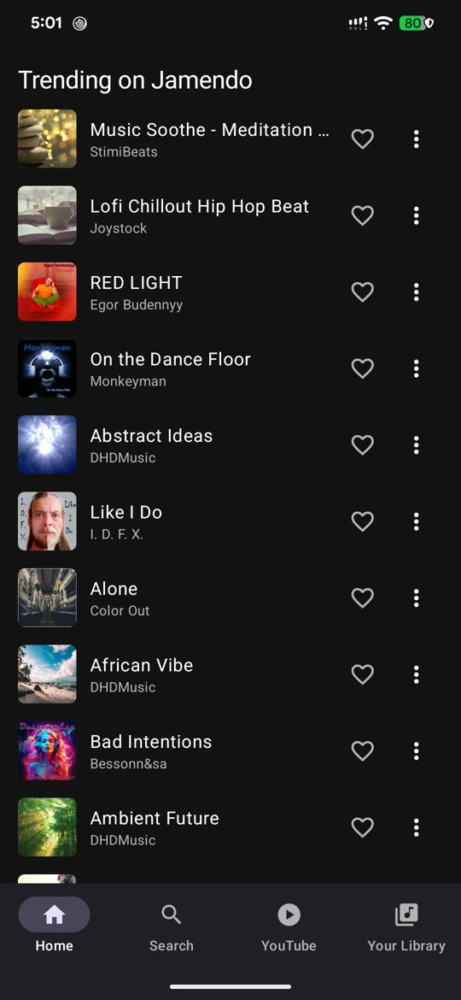
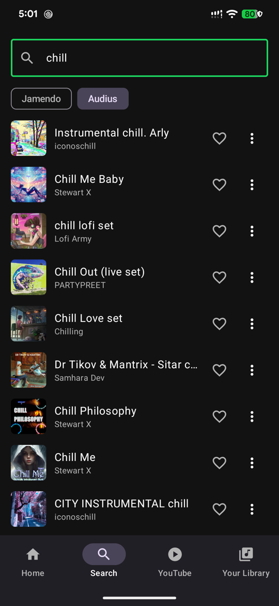
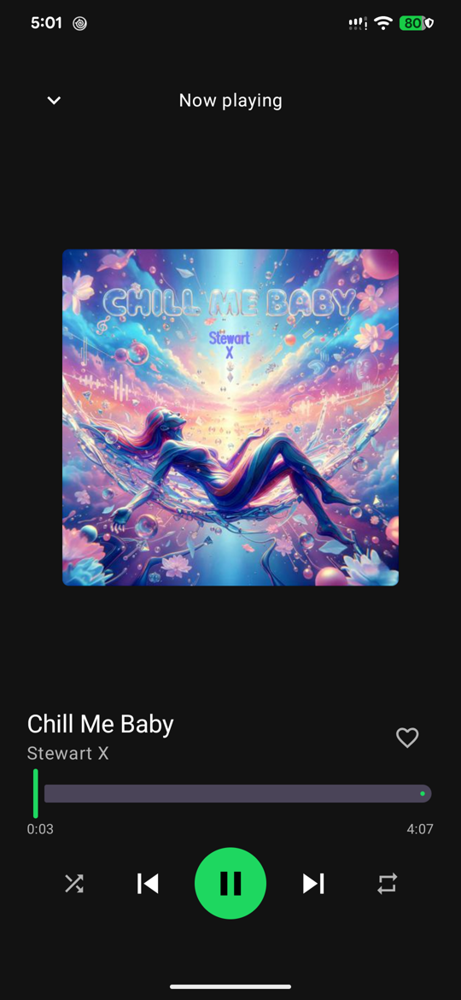

# Openwave

A free, Spotify-style music player for Android. It streams music that is licensed for free
streaming, plays the audio files and video songs already on your phone, and embeds YouTube through
YouTube's own player. No account, no subscription, no ads of its own.

<p>
  
  
  
</p>

## Features

- **Free streaming** from two legal catalogs: [Jamendo](https://www.jamendo.com) and [Audius](https://audius.co)
- **Your own music:** plays audio files on the phone, and plays **video files as audio only**
  (music videos, clips). Videos in folders named like *Music* or *Songs* are listed as **Video songs**;
  mark any other folder with ⋮ → *Use this folder for songs*
- **YouTube tab:** search or paste a link; videos open in YouTube's own site and player at the lowest quality
- **Player:** mini player and full player, seek, shuffle, repeat, background playback, and a
  notification with lock-screen controls and a close button
- **Library:** liked songs and playlists, stored on the device
- **Downloads:** save tracks the source allows (all of Jamendo, and Audius tracks whose artist enabled
  downloads) to `Music/Free Music/` so they play offline and show up in your Songs list

## Build and run

You need [Android Studio](https://developer.android.com/studio) (or the Android SDK with JDK 17+)
and a phone or emulator running Android 8.0 (API 26) or newer.

1. **Get a free Jamendo client ID** at <https://devportal.jamendo.com>.
2. Copy the example config and fill it in:

   ```bash
   cp local.properties.example local.properties
   ```

   ```properties
   sdk.dir=/path/to/your/Android/Sdk      # Android Studio adds this for you
   JAMENDO_CLIENT_ID=your_client_id
   YOUTUBE_API_KEY=                       # optional, see below
   ```

3. Open the folder in Android Studio and press **Run**, or from a terminal:

   ```bash
   ./gradlew :app:assembleDebug
   adb install -r app/build/outputs/apk/debug/app-debug.apk
   ```

`local.properties` is git-ignored, so your keys are never committed. Keep it that way: a key
compiled into an APK can be extracted by anyone who has the app, so use keys you can rotate and don't
put client secrets in this project (the app doesn't need them).

### Optional: YouTube search results list

Without a key, the YouTube tab searches on YouTube's own site inside the app, and pasting a link works.
With a [YouTube Data API v3](https://console.cloud.google.com/apis/credentials) key in
`YOUTUBE_API_KEY`, search shows a plain results list instead.

Audius needs no key. Without a Jamendo ID, Home still shows Audius and your local music still plays.

## How it's built

| Area | What it uses |
|---|---|
| UI | Kotlin, Jetpack Compose, Material 3 |
| Playback | AndroidX Media3 (ExoPlayer + MediaSession) in a foreground service |
| Storage | Room (liked songs, playlists, downloads) |
| Networking | Retrofit, Gson, Coil (images, video thumbnails) |
| Local files | MediaStore (audio and video) |

```
app/src/main/java/com/freemusic/app/
├── MainActivity.kt, FreeMusicApp.kt   entry point, image loader
├── MusicViewModel.kt                  state, search, playback and library actions
├── PlaybackService.kt                 background player, notification, close action
├── data/                              Room, Jamendo, Audius, YouTube, MediaStore, downloads
└── ui/                                Compose screens and components
```

## What it doesn't do

Openwave only plays music that you have the right to play: free-licensed catalogs, your own files,
and YouTube inside YouTube's own player. It does **not** download or extract audio or video from
YouTube, and it can't stream Spotify or any other paid catalog. Those would break the services'
terms and the rights holders' copyright, so pull requests that add them won't be accepted.

Notes on the sources:

- Jamendo's free API is intended for non-commercial use. Check their terms before publishing the app.
- Audius lists independent artists; each artist decides whether their tracks can be downloaded.
- Video quality on YouTube is requested through an unofficial player call, so it may stop working if
  YouTube changes its site.

## Contributing

Issues and pull requests are welcome. Please open an issue first for larger changes.

## License

[MIT](LICENSE). This covers Openwave's code only. The music, artwork and videos it plays belong to
their artists and rights holders and remain under their own licenses and terms.
